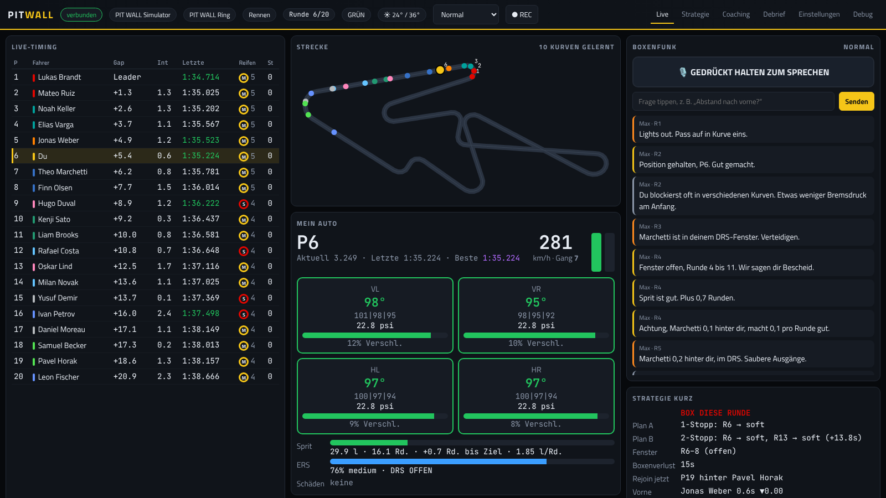

# PIT WALL 🏁 – dein KI-Renningenieur

**[English version → README.en.md](README.en.md)**

PIT WALL sitzt am Kommandostand, während du fährst: Er liest die Live-Telemetrie deiner Rennsimulation,
meldet sich per **Boxenfunk** mit Abständen, Sprit, Reifen, Strategie und Gefahren – und beantwortet deine
Fragen, wenn du die **Funktaste am Lenkrad** drückst. Als Gehirn dient **Claude** (Anthropic); jede Zahl, die
er nennt, kommt aus echten Daten. Ohne Internet oder API-Key funktioniert der Funk weiter (Phrasebook-Modus).



*Dashboard im eingebauten Simulator (Szenario „undercut“). Das Overlay für OBS zeigt den aktuellen Funkspruch:*


*(GIF-Platzhalter: Funk mit Overlay im Spiel – folgt nach den ersten Live-Tests.)*

## Was er kann

- **Proaktiver Funk** auf Deutsch (oder Englisch) mit echtem Funk-Klang: Abstände und Trends, Undercut-Gefahr,
  Boxenfenster, Safety Car („Box, box – Stopp kostet unter SC nur elf Sekunden“), Sprit-Sparziele mit
  Lift-and-Coast, Reifentemperaturen, Wetterumschwung, Schäden, Strafen, Bestzeiten.
- **Timing wie ein echter Engineer**: spricht auf Geraden, schweigt in Bremszonen und in den letzten Kurven,
  rationiert Infos pro Runde, Kritisches unterbricht alles. Modi *gesprächig / normal / nur Wichtiges / stumm*
  – auch per Zuruf („Funk ruhig“).
- **Fragen per Push-to-Talk** (Lenkradtaste, evdev/SDL): Sofort-Antworten in < 300 ms für Standardfragen
  („Abstand nach vorne?“, „Sprit?“, „Wann boxen?“), freie Fragen über Claude mit Tool Use.
- **Strategie-Engine**: Sprit (robuste Messung), sprit-korrigierte Reifendegradation, 0–3-Stopp-Pläne,
  Wiedereinstiegs-Prognose, Undercut/Overcut, SC-Stopp-Gewinn, Wetter-Crossover.
- **Coaching**: Kurve für Kurve gegen deine Bestrunde – Bremspunkt, Minimalspeed, Gas, Blockieren, Wheelspin.
- **Langzeitgedächtnis** (SQLite): Verbrauch, Boxenverlust, Schwachkurven und Notizen je Strecke/Auto.
- **Debrief** nach dem Rennen, **Dashboard** (Tablet/Handy im LAN) und **OBS-Overlay**.
- **Recorder & Replay**: jedes Rennen aufnehmen und später mit dem Engineer erneut abspielen.
- **ETS2/ATS**: Disponenten-Modus mit Auftrag, Deadline, Pausen, Reichweite, Tempolimit und Schäden.

## Unterstützte Spiele

| Spiel | Verbindung | Anleitung |
|---|---|---|
| F1 24 / F1 25 | UDP-Telemetrie | [docs/setup-f1.md](docs/setup-f1.md) |
| Gran Turismo 7 (PS5) | UDP im LAN (verschlüsselt, Heartbeat) | [docs/setup-gt7.md](docs/setup-gt7.md) |
| Assetto Corsa | Shared Memory + UDP + In-Game-App | [docs/setup-assetto-corsa.md](docs/setup-assetto-corsa.md) |
| Assetto Corsa Competizione | Broadcasting-API + Shared Memory | [docs/setup-acc.md](docs/setup-acc.md) |
| iRacing | irsdk Shared Memory | [docs/setup-iracing.md](docs/setup-iracing.md) |
| rFactor 2 / Le Mans Ultimate | Shared Memory (Plugin / `LMU_Data`) | [docs/setup-rfactor2-lmu.md](docs/setup-rfactor2-lmu.md) |
| Euro Truck Simulator 2 / ATS | SCS-Telemetry-Plugin | [docs/setup-ets2.md](docs/setup-ets2.md) |

Linux mit Proton (z. B. Bazzite): **[docs/linux-proton.md](docs/linux-proton.md)** – inklusive der
mitgelieferten Bridge `pitwall-relay.exe`, die Shared Memory aus dem Proton-Prefix zu PIT WALL schickt.

## Schnellstart

**Linux (Bazzite & Co.) – ein Befehl zum Installieren:**

```bash
curl -fsSL https://raw.githubusercontent.com/kaivoegele08-hash/Chef-/claude/pitwall-race-engineer/install.sh | bash
```

(Oder nach `git clone …`: `bash install.sh` im Ordner.) Danach überall im Terminal:

```bash
pitwall          # starten – Spiel wird automatisch erkannt
pitwall test     # Testrennen ohne Spiel
pitwall doctor   # prüft Audio, Funktaste, Ports, Proton und ob Spieldaten ankommen
pitwall update   # neueste Version holen
```

Im Startmenü gibt es außerdem den Eintrag **PIT WALL**.

**Windows**

```powershell
irm https://astral.sh/uv/install.ps1 | iex
.\start.ps1 --sim simulator
.\start.ps1
```

Beim ersten Start legt das Skript die Python-Umgebung an und lädt die deutsche Piper-Stimme (≈ 60 MB).

### Claude aktivieren (optional)

Dashboard → **Einstellungen → Claude**: API-Key eintragen. Er wird nur lokal in `~/.config/pitwall/.env`
gespeichert, nie im Browser. Standard: *Claude Haiku* für schnelle Funkantworten, *Claude Sonnet* für
Strategie-Updates; das Dashboard zeigt Token-Verbrauch und Kosten. Ohne Key: Phrasebook-Modus, alle
proaktiven Durchsagen und Standardfragen funktionieren trotzdem.

### Funktaste anlernen

Dashboard → Einstellungen → **Funktaste anlernen** → Taste am Lenkrad drücken. Solange sie gedrückt ist,
hört PIT WALL zu (lokale Spracherkennung mit faster-whisper) – sonst ist das Mikrofon aus.

## Befehle

| Befehl | Zweck |
|---|---|
| `pitwall run [--sim f1]` | Engineer + Dashboard starten (`--sim auto` = Erkennung) |
| `pitwall run --sim simulator --scenario sc_window` | Simulator: `default`, `undercut`, `sc_window`, `fuel_critical`, `rain`, `flashback`, `restart`, `quali`, `gt`, `damage`, `hot_tyres` |
| `pitwall run --replay rennen.pwrec --speed 4` | Aufnahme abspielen |
| `pitwall dry-run --laps 20 --debrief` | Rennen als Text-Funkprotokoll |
| `pitwall doctor [--sim acc]` | Setup- und Datenprüfung |
| `pitwall record --sim f1 --out rennen.pwrec` | nur aufnehmen |
| `pitwall say "Funkcheck"` · `pitwall devices` · `pitwall voices list` | Audio testen |

## Konfiguration

- `config/default.toml` – alle Einstellungen (Sprache, Engineer-Name, Gesprächigkeit, Ports, Audio, Modelle).
  Eigene Änderungen landen in `~/.config/pitwall/config.toml` (auch über das Dashboard).
- `config/sims/*.toml` – Reifenfenster, Mischungen, Regeln je Sim. `config/tracks/*.toml` – Boxenverlust & Co.
- `.env` (`~/.config/pitwall/.env`) – `ANTHROPIC_API_KEY`, optional `ELEVENLABS_API_KEY`, `ACC_BROADCAST_PASSWORD`.
- Logs: `~/.local/share/pitwall/logs/pitwall.log` (Windows: `%LOCALAPPDATA%\pitwall\logs`).

## Datenschutz & Kosten

Mikrofon nur bei gedrückter Taste. Telemetrie bleibt lokal; an Claude gehen nur die Frage, der Funkverlauf
und die Tool-Ergebnisse. Kostenpflichtige Dienste (Claude, optional ElevenLabs) sind erst aktiv, wenn du
einen Key einträgst; ein Tagesbudget begrenzt die Ausgaben.

## Entwicklung

Siehe [CLAUDE.md](CLAUDE.md) (Architektur, Konventionen) und [docs/PLAN.md](docs/PLAN.md) (Plan, Status, Risiken).
Protokoll-Recherche mit Quellen: [docs/protocols/](docs/protocols/).

```bash
uv pip install -e '.[all,dev]'
.venv/bin/python -m pytest -q && .venv/bin/ruff check pitwall tests
```

## Lizenz und Danksagungen

Eigener Code: MIT. Telemetrie-Protokolle wurden anhand öffentlicher Dokumentation neu implementiert
(Quellen in `docs/protocols/`). Piper-Stimmen und optionale Pakete stehen unter ihren eigenen Lizenzen
(Piper: GPL-3, wird nur als optionale Laufzeitabhängigkeit genutzt). Spiele und Marken gehören ihren Inhabern;
PIT WALL ist kein offizielles Produkt der Hersteller.
